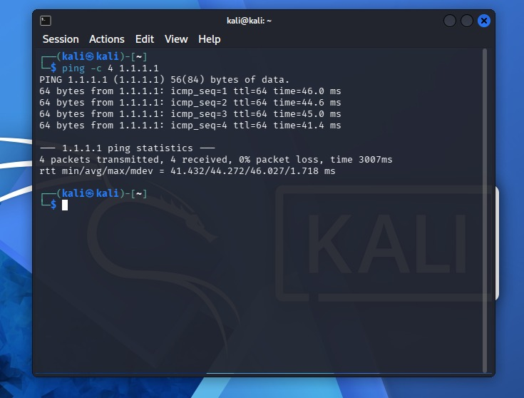
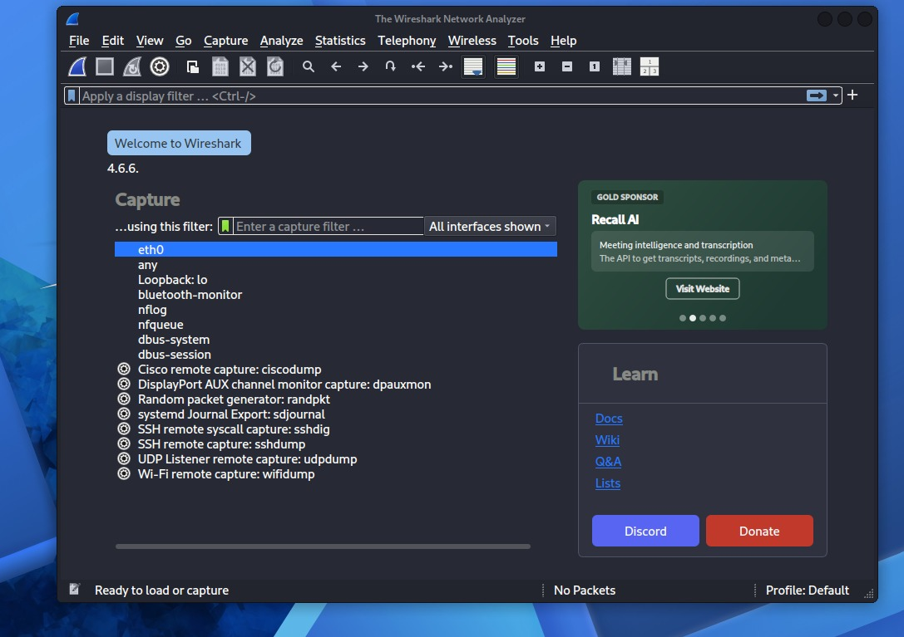
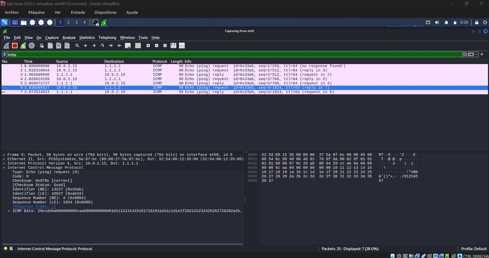

# ICMP Traffic Analysis — Technical Report

**Project:** Network Traffic Analysis & Threat Detection Using Wireshark

**Lab:** 01 — ICMP Traffic Analysis

**Tools:** Kali Linux, Wireshark

**Analysis Type:** Network Connectivity and Protocol Inspection

## 1. Objective

Analyze ICMP Echo Request and Echo Reply packets to understand network connectivity testing and basic packet inspection.

## 2. Methodology

A controlled connectivity test was performed from a Kali Linux virtual machine using the following command:

`ping -c 4 1.1.1.1`

Network traffic was captured using Wireshark and examined with the `icmp` display filter.

## 3. Technical Findings

- The source IP address was `10.0.2.15`.
- The destination IP address was `1.1.1.1`.
- ICMP Echo Request and Echo Reply packets were observed.
- The connectivity test reported 0% packet loss.
- The inspected ICMP payload contained a timestamp and test data.
- No obvious sensitive information was identified in the inspected payload.

## 4. Security Relevance

ICMP traffic is commonly used for network diagnostics and connectivity testing.

In a SOC environment, ICMP analysis can also help identify unusual communication patterns, such as excessive echo requests or unexpected connectivity testing between network segments.

However, the traffic observed in this laboratory was generated intentionally and did not indicate a security incident.

## 5. Conclusion

The laboratory demonstrated successful ICMP communication and provided practical experience examining packet headers, IP addresses, and protocol data in Wireshark.

The exercise reinforced fundamental packet analysis skills relevant to entry-level SOC investigations.

## 6. Evidence

### Packet Capture

**Packet capture:** SOC-Lab-01-ICMP-Analysis.pcapng

*The original packet capture is retained locally and is not included in the public repository pending a privacy review.*

### ICMP Connectivity Test

### Wireshark ICMP Packet Capture

### ICMP Packet Details

