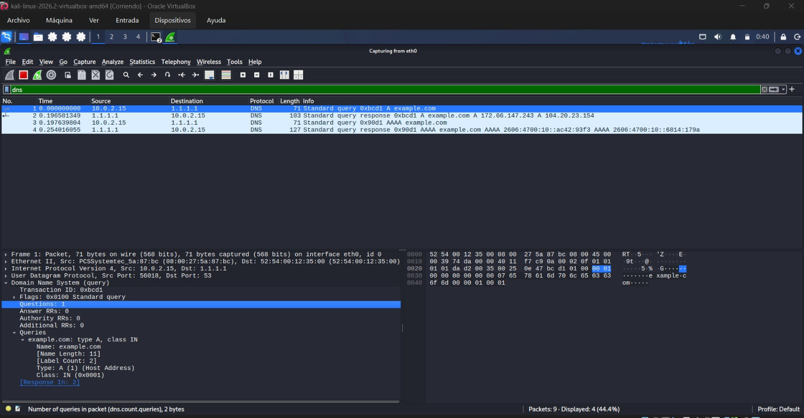
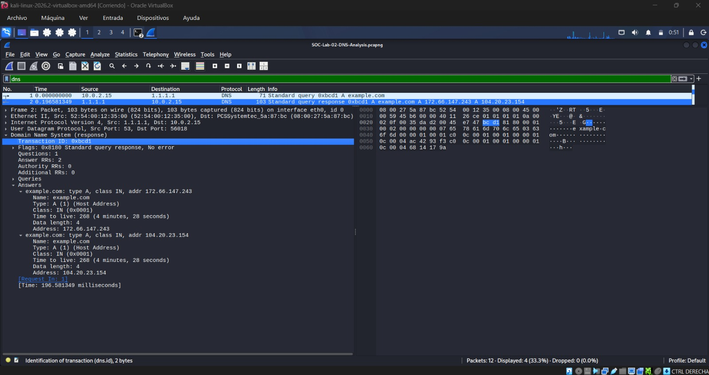
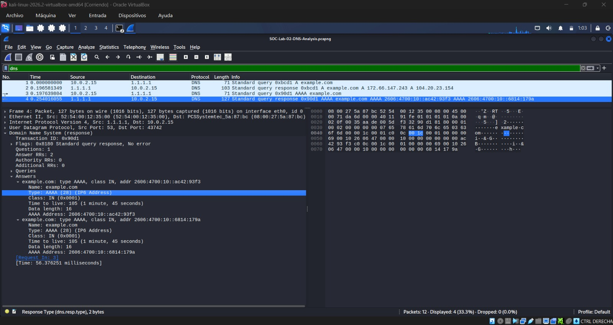

# DNS Traffic Analysis — Technical Report

**Project:** Network Traffic Analysis & Threat Detection Using Wireshark

**Lab:** 02 — DNS Traffic Analysis

**Tools:** Kali Linux, Wireshark

**Analysis Type:** DNS Protocol Inspection and Network Traffic Analysis

## 1. Objective

Analyze DNS queries and responses to understand how domain names are resolved into IP addresses and how DNS traffic can be investigated using Wireshark.

## 2. Methodology

DNS resolution for `example.com` was examined in a controlled Kali Linux virtual environment.

Wireshark was used to capture and inspect DNS packets using the following display filter:

`dns`

The investigation focused on identifying DNS queries, responses, record types, resolved IP addresses, and Time to Live (TTL) values.

## 3. Technical Findings

- DNS queries and responses associated with `example.com` were identified.
- IPv4 addresses were observed in DNS A records.
- IPv6 addresses were observed in DNS AAAA records.
- The DNS responses included IPv4 addresses `172.66.147.243` and `104.20.23.154`.
- DNS TTL values were examined to understand how long resolution results may be cached.
- The captured AAAA response included a TTL value of 105 seconds.

## 4. Security Relevance

DNS analysis is an important skill for Security Operations Center (SOC) analysts.

Investigating DNS traffic can help identify suspicious domains, unusual query patterns, potential command-and-control communication, and possible DNS tunneling activity.

However, DNS queries alone do not confirm malicious behavior. Analysts must correlate network evidence with additional security context.

The traffic examined in this laboratory was generated as part of an authorized learning exercise.

## 5. Conclusion

This laboratory demonstrated the DNS resolution process and provided hands-on experience inspecting DNS queries, responses, IPv4 and IPv6 records, and TTL values.

The exercise strengthened fundamental network analysis skills relevant to SOC monitoring and security investigations.

## 6. Evidence

**Packet capture:** SOC-Lab-02-DNS-Analysis.pcapng

*The original packet capture is retained locally and is not included in the public repository pending a privacy review.*

### DNS Query Analysis

### DNS Response Details

### DNS IPv6 Analysis

