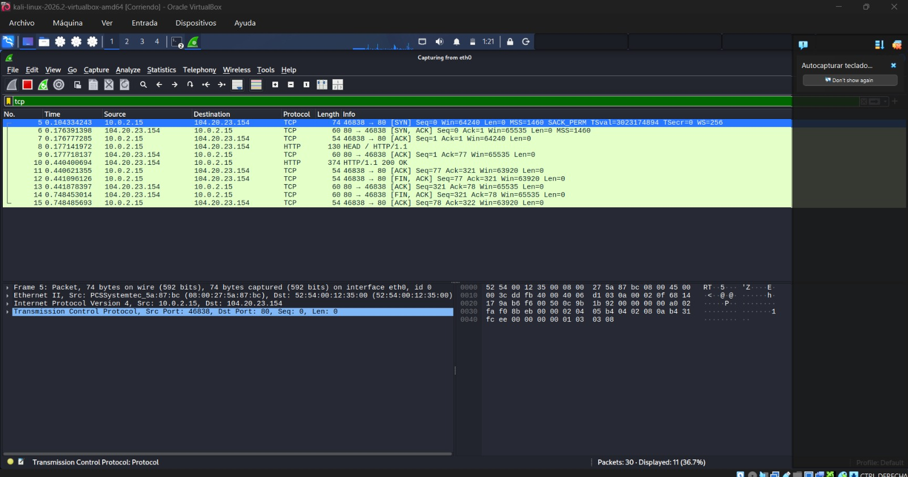
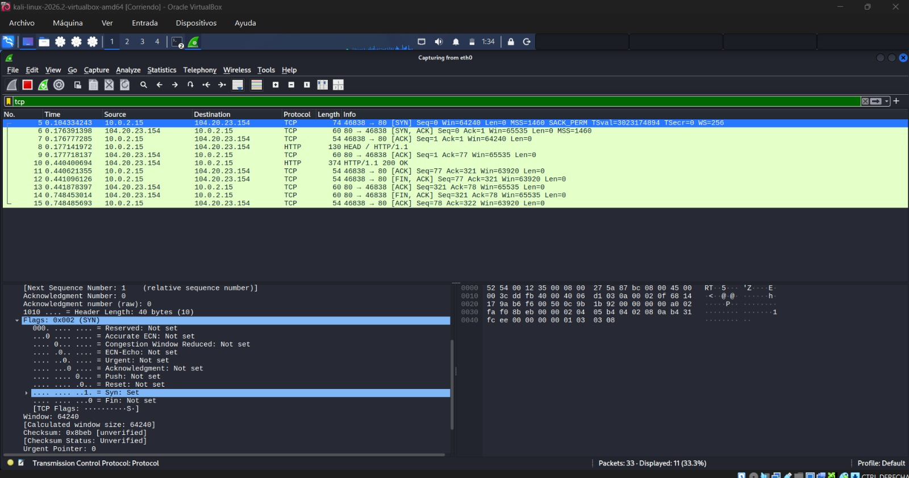
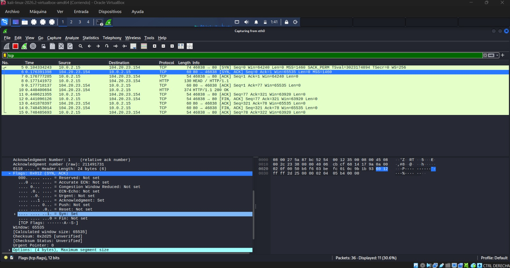
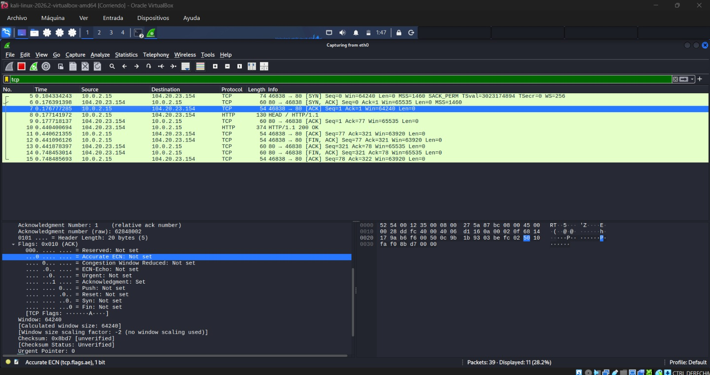

# TCP Three-Way Handshake Analysis — Technical Report

**Project:** Network Traffic Analysis & Threat Detection Using Wireshark

**Lab:** 03 — TCP Three-Way Handshake

**Tools:** Kali Linux, Wireshark

**Analysis Type:** TCP Connection Establishment and Packet Inspection

## 1. Objective

Analyze the TCP Three-Way Handshake to understand how TCP connections are established and how connection flags can be identified using Wireshark.

## 2. Methodology

A TCP connection to a remote web server was generated in a controlled Kali Linux virtual environment.

Wireshark was used to capture and inspect TCP packets associated with the connection.

The investigation focused on identifying the three stages of connection establishment and examining the TCP flags.

**Wireshark display filter:**

`tcp`

## 3. Technical Findings

The captured connection involved the following network endpoints:

- **Client IP:** `10.0.2.15`
- **Server IP:** `104.20.23.154`
- **Destination Port:** `80`
- **Transport Protocol:** TCP

The following handshake stages were identified:

| Stage | TCP Flags | Hexadecimal Value | Description |
|---|---|---|---|
| 1 | SYN | `0x002` | Client initiates the connection |
| 2 | SYN, ACK | `0x012` | Server acknowledges the connection request |
| 3 | ACK | `0x010` | Client completes the handshake |

The packet sequence demonstrated successful TCP connection establishment.

## 4. Security Relevance

Understanding TCP connection establishment is essential for SOC analysts investigating network activity.

TCP flag analysis can help identify connection attempts, unsuccessful connections, reconnaissance patterns, and potentially suspicious network behavior.

However, individual TCP flags are not sufficient to establish malicious intent. Additional investigation and contextual evidence are required.

## 5. Conclusion

This laboratory demonstrated the TCP Three-Way Handshake and provided practical experience identifying SYN, SYN-ACK, and ACK packets.

The analysis strengthened fundamental packet inspection skills relevant to network monitoring and entry-level SOC investigations.

## 6. Evidence

**Packet capture:** SOC-Lab-03-TCP-Analysis.pcapng

*The original packet capture is retained locally and is not included in the public repository pending a privacy review.*

### TCP Three-Way Handshake

### TCP SYN Flag Analysis

### TCP SYN-ACK Flag Analysis

### TCP Final ACK Analysis

