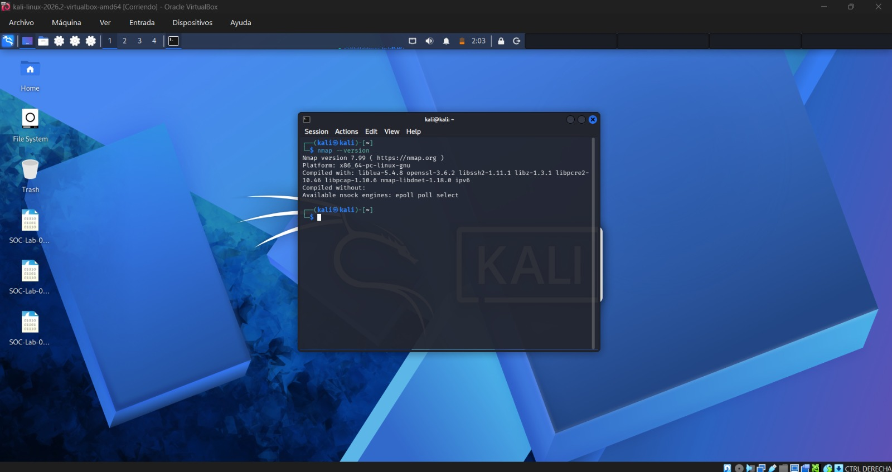
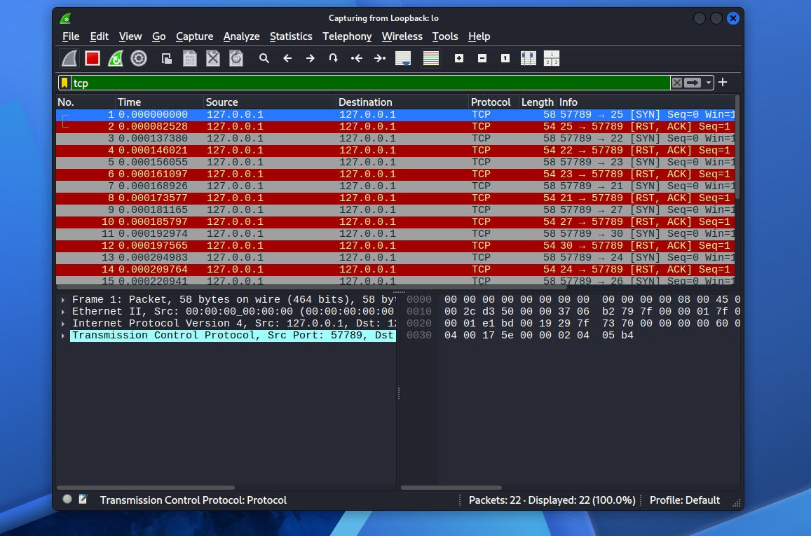

# TCP SYN Port Scan Detection — Technical Report

**Project:** Network Traffic Analysis & Threat Detection Using Wireshark

**Lab:** 04 — SYN Port Scan Detection

**Tools:** Kali Linux, Wireshark, Nmap 7.99

**Analysis Type:** Network Reconnaissance and TCP Flag Analysis

## 1. Objective

Identify and analyze TCP SYN port scanning activity using Wireshark and Nmap in a controlled laboratory environment.

The goal was to understand how port scanning appears in network traffic and how SOC analysts can recognize reconnaissance patterns.

## 2. Methodology

A controlled TCP SYN scan was performed against the local loopback interface (`127.0.0.1`).

The following command was executed:

```bash
sudo nmap -sS -Pn -p 20-30 127.0.0.1
```

The scan targeted TCP ports 20 through 30.

Wireshark was configured to capture traffic on the loopback interface (`lo`).

The following display filter was applied:

```text
tcp
```

The captured packets were examined to identify TCP connection attempts and responses.

## 3. Technical Findings

The investigation produced the following observations:

| Indicator | Observation |
|---|---|
| Source IP | 127.0.0.1 |
| Destination IP | 127.0.0.1 |
| Scanned ports | TCP 20–30 |
| Ports scanned | 11 |
| SYN requests | 11 |
| RST-ACK responses | 11 |
| Port status | Closed |
| TCP packets observed | 22 |

### SYN Packet Analysis

Nmap transmitted TCP SYN packets to multiple destination ports to determine their status.

These packets initiated connection attempts without completing a full TCP handshake.

### RST-ACK Response Analysis

The scanned ports returned TCP RST-ACK packets.

These responses indicated that the targeted TCP ports were closed.

### Traffic Pattern

The capture demonstrated a sequence of SYN packets targeting multiple ports within a short period.

This pattern is consistent with TCP SYN port scanning activity.

## 4. Security Relevance

Port scanning is commonly associated with network reconnaissance.

In a production SOC environment, repeated SYN packets directed toward multiple ports may warrant further investigation.

An analyst should consider:

- Whether the scanning activity was authorized.
- The source and destination of the traffic.
- The number and range of targeted ports.
- The frequency of connection attempts.
- Whether additional suspicious activity occurred.

Port scanning is not inherently malicious. Authorized administrators and security professionals regularly use scanning tools for legitimate purposes.

In this laboratory, the activity was intentionally generated against the local machine and did not represent a real security incident.

## 5. Conclusion

This laboratory demonstrated how TCP SYN port scanning can be identified through packet-level analysis.

Wireshark captured 11 SYN requests and 11 RST-ACK responses associated with a controlled Nmap scan.

The exercise provided practical experience identifying reconnaissance patterns, interpreting TCP flags, and distinguishing authorized testing from potentially suspicious activity.

These skills are relevant to entry-level SOC monitoring and network security investigations.

## 6. Evidence

*Packet capture:* SOC-Lab-04-Port-Scan-Analysis.pcapng

The original packet capture is retained locally and is not included in the public repository pending a privacy review.

### Nmap Version Verification



### SYN Port Scan Detection

